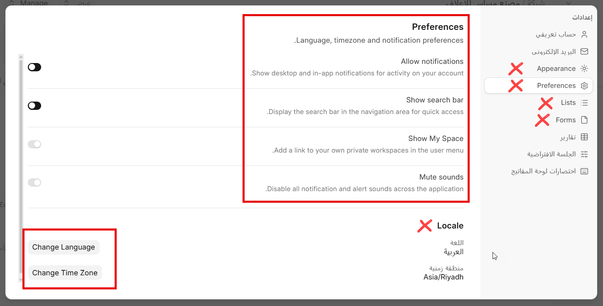
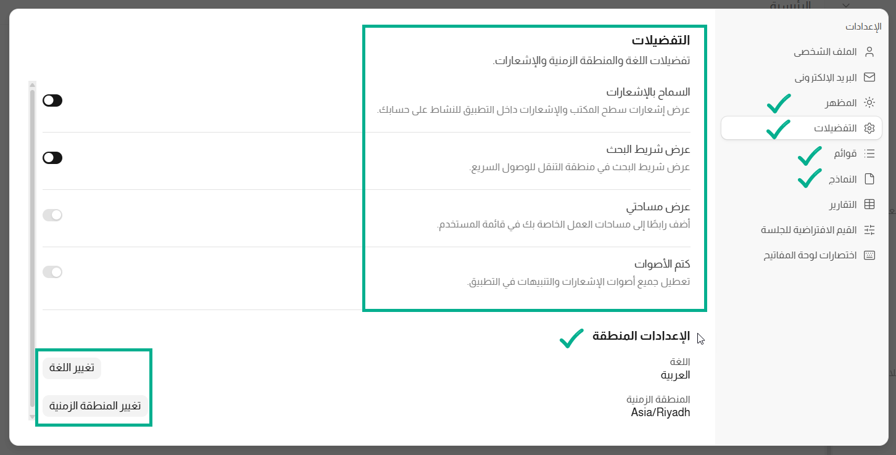

<p align="center">
  
</p>

# DaaD - Making ERPNext Truly Arabic

**DaaD** (ضاد) is an open-source Frappe app that gives ERPNext a human-made Arabic translation and the Almarai typeface across the whole system. This is the **version-15** branch, for **ERPNext v15**. For ERPNext v16, use the [`version-16`](https://github.com/itsystematic/daad/tree/version-16) branch.

Arabic is known as *the language of Ḍād* (لغة الضاد). This app is our contribution to the Frappe community in the Arab world.

> **بالعربي:** ترجمة عربية بشرية لنظام ERPNext v15، مع خط المراعي في كل أجزاء النظام. مجانية ومفتوحة المصدر.

> **Community app.** DaaD covers Frappe, ERPNext and HRMS only. It is **not for sites running [Optima ZATCA](https://github.com/itsystematic/optima_zatca)**: Optima ZATCA already carries its own Arabic translation and the Almarai font, and the two apps would override each other's translations and font settings. On such a site, uninstall DaaD.

---

## 📸 Before & After

Screenshots taken on version 16.

| Before (default) | After (DaaD) |
|---|---|
|  |  |

---

## 🚀 What's Inside

### **Human Arabic Translation**
- **15,133 strings** translated by people who implement ERPNext every day — not machine translation.
- Made for **ERPNext, Frappe and HRMS** version 16 and shipped here in the CSV format that version 15 reads. About **9,700** of them match strings in version 15. A version 15 string that DaaD does not cover keeps the Arabic that ships with Frappe, ERPNext and HRMS.
- Includes the hard places: dashboards, settings dialogs, popups and tooltips.
- Business terminology chosen for real use in Saudi and Gulf companies.

### **Almarai Font**
- **Almarai** applied to the Desk, Website, Portal and print preview.
- **4 weights** (Light 300, Regular 400, Bold 700, ExtraBold 800), each with Arabic and Latin subsets.
- Self-hosted inside the app — no calls to Google Fonts.
- Frappe Charts (axes, legends, tooltips) use the same font.

---

## 🧭 How Version 15 Differs

| | version-15 | version-16 |
|---|---|---|
| Translation file | `daad/translations/ar.csv` | `daad/locale/ar.po` |
| How Frappe loads it | Read directly from the CSV | Compiled to a `.mo` file by `bench build` |
| Desk label fixes | Not needed: v15 already translates its sidebar and filter labels | `daad_i18n.js` translates the dock, sidebar and a few titles |
| Python | 3.10 or later | 3.14 or later |

---

## 📦 Installation

1. Get the app:
   ```bash
   bench get-app https://github.com/itsystematic/daad.git --branch version-15
   ```
2. Build the app:
   ```bash
   bench build --app daad
   ```
3. Install the app on your site:
   ```bash
   bench --site [your.site.name] install-app daad
   ```
4. Clear the cache and restart:
   ```bash
   bench --site [your.site.name] clear-cache
   bench restart
   ```
5. Set the language to **Arabic** from **User Settings → Preferences → Change Language**, or for the whole system from **System Settings**.

DaaD's Arabic overrides the apps installed before it. If ERPNext or HRMS is installed after DaaD, `bench migrate` writes a warning to the Error Log. Move DaaD after them in **Installed Applications**.

### Supported Versions
- ERPNext / Frappe **Version 15**, on Python 3.10 or later.
- Version 16 lives on the `version-16` branch.

---

## 🔄 Updates

We review and update the translation **every three months**, following new ERPNext releases. To get the latest version:

```bash
cd apps/daad && git pull
bench build --app daad
bench --site [your.site.name] clear-cache
```

---

## 🤝 Contributing

Found a wrong or missing translation? We welcome your help.

1. Fork the repository.
2. Edit `daad/translations/ar.csv`. Each row is the English source, then the Arabic translation; ambiguous terms have a third column with the context. Save the file as UTF-8.
3. Keep the English source text exactly as it appears in Frappe (including punctuation and placeholders like `{0}`). A source text that spans several lines stays in one quoted cell.
4. Open a pull request against `version-15` and explain the change, with a screenshot if possible.

A fix that applies to both versions is best made in `daad/locale/ar.po` on the `version-16` branch; this branch's CSV is then brought up to date from it. `ar.po` is generated from IT Systematic's maintained Arabic source, so accepted pull requests stay in every later release.

You can also report a problem in [GitHub Issues](https://github.com/itsystematic/daad/issues).

This app uses `pre-commit` for formatting and linting:

```bash
cd apps/daad
pre-commit install
```

---

## 🛠️ For Maintainers

### Bring in version 16's Arabic

From the bench folder:

```bash
git -C apps/daad fetch --depth 1 upstream version-16
git -C apps/daad show FETCH_HEAD:daad/locale/ar.po > /tmp/daad-ar.po
bench daad-import-po /tmp/daad-ar.po
```

The command adds new entries and updates changed ones. Rows the PO file lacks stay in the CSV, so version 15 strings added through a harvest survive the import. It reads the CSV back the way Frappe does and stops with an error if the file would not load as written.

### Harvest Arabic found outside DaaD

```bash
bench --site [your.site.name] daad-harvest
```

This writes `apps/daad/daad/harvest/<date>.csv` and prints its full path. It has one row per string whose Arabic in Frappe, ERPNext, HRMS, any other installed app or the site's **Translation** records is new to DaaD (`new`) or differs from it (`differs`), plus core strings with no Arabic anywhere (`missing`). Review it, put `yes` in the `approved` column of each row to keep (for a `missing` row, write the Arabic in `found_translation`), then merge it using the full path the harvest printed:

```bash
bench --site [your.site.name] daad-harvest --apply /full/path/to/apps/daad/daad/harvest/<date>.csv
bench --site [your.site.name] clear-cache
```

---

## 📜 License

- **App code and translations:** GNU General Public License v3.0. See [license.txt](license.txt).
- **Almarai font:** SIL Open Font License 1.1, © The Almarai Project Authors. See [OFL.txt](daad/public/fonts/OFL.txt).

---

## 📂 More Apps by IT Systematic

- **[Optima ZATCA](https://github.com/itsystematic/optima_zatca):** ZATCA e-invoicing compliance (Phase 1 & 2) for ERPNext.
- **[Optima Payment](https://github.com/itsystematic/optima_payment):** Post-dated cheques, company expenses and bank guarantees.
- **[Optima HR](https://github.com/itsystematic/optima-hr):** HR for Saudi Arabia on ERPNext.
