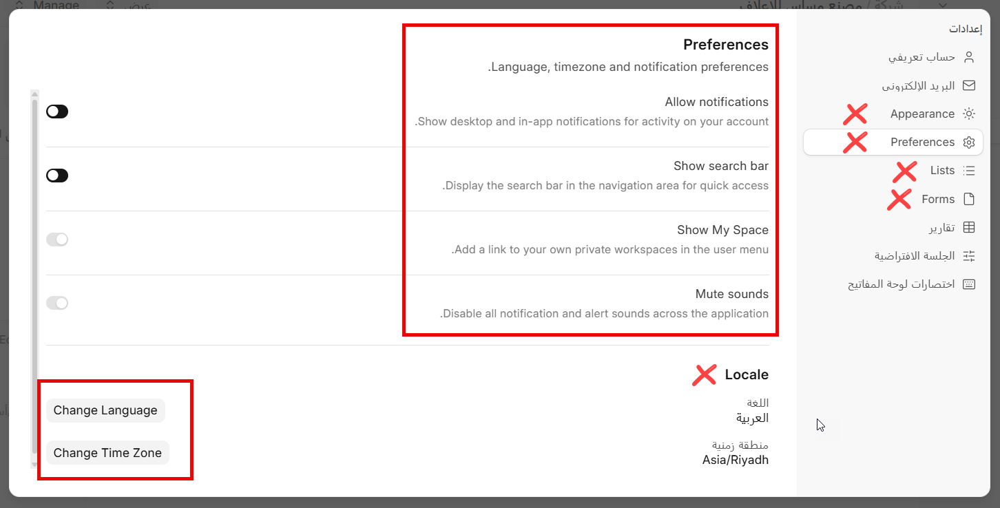
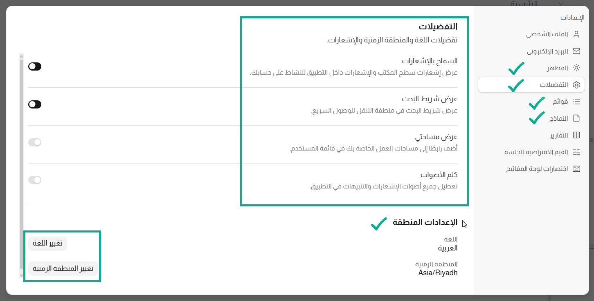

<p align="center">
  
</p>

# DaaD - Making ERPNext Truly Arabic

**DaaD** (ضاد) is an open-source Frappe app that gives ERPNext a complete, human-made Arabic translation and the Almarai typeface across the whole system. It supports the latest release, **ERPNext v16.50**.

Arabic is known as *the language of Ḍād* (لغة الضاد). This app is our contribution to the Frappe community in the Arab world.

> **بالعربي:** ترجمة عربية بشرية كاملة لنظام ERPNext v16، مع خط المراعي في كل أجزاء النظام. مجانية ومفتوحة المصدر.

> **Community app.** DaaD covers Frappe, ERPNext and HRMS only. It is **not for sites running [Optima ZATCA](https://github.com/itsystematic/optima_zatca)**: Optima ZATCA already carries this translation, the Arabic of the Optima apps and the Almarai font, and the two apps would override each other's translations and font settings. On such a site, uninstall DaaD.

---

## 📸 Before & After

| Before (default) | After (DaaD) |
|---|---|
|  |  |

---

## 🚀 What's Inside

### **Human Arabic Translation**
- **15,133 strings** translated by people who implement ERPNext every day — not machine translation.
- Covers **ERPNext, Frappe and HRMS** for **version 16**.
- Includes the hard places: dashboards, settings dialogs, the new **dock** and sidebar, popups and tooltips.
- The **HR module** is fully translated.
- Business terminology chosen for real use in Saudi and Gulf companies.

### **Client-side Translation Fixes**
Some labels in Frappe are rendered without `__()`, so a normal translation file cannot reach them. DaaD includes a small script that translates:
- Module dock labels and tooltips
- Sidebar items and section headings
- Filter counters and a few built-in button titles

### **Almarai Font**
- **Almarai** applied to the Desk, Website, Portal and print preview.
- **4 weights** (Light 300, Regular 400, Bold 700, ExtraBold 800), each with Arabic and Latin subsets.
- Self-hosted inside the app — no calls to Google Fonts.
- Frappe Charts (axes, legends, tooltips) use the same font.

---

## 📦 Installation

1. Get the app:
   ```bash
   bench get-app https://github.com/itsystematic/daad.git --branch version-16
   ```
2. Build the app:
   ```bash
   bench build --app daad
   ```
3. Install the app on your site:
   ```bash
   bench --site [your.site.name] install-app daad
   ```
4. Clear the cache and restart:
   ```bash
   bench --site [your.site.name] clear-cache
   bench restart
   ```
5. Set the language to **Arabic** from **User Settings → Preferences → Change Language**, or for the whole system from **System Settings**.

### Supported Versions
- ERPNext / Frappe **Version 16**, built on the latest release **ERPNext v16.50** (Frappe v16.51, HRMS v16.50)

---

## 🔄 Updates

We review and update the translation **every three months**, following new ERPNext releases. To get the latest version:

```bash
cd apps/daad && git pull
bench build --app daad
bench --site [your.site.name] clear-cache
```

---

## 🤝 Contributing

Found a wrong or missing translation? We welcome your help.

1. Fork the repository.
2. Edit `daad/locale/ar.po`. Each entry is a `msgid` (English source) with its `msgstr` (Arabic translation); ambiguous terms also have a `msgctxt`.
3. Keep the English source text exactly as it appears in Frappe (including punctuation and placeholders like `{0}`).
4. Open a pull request and explain the change, with a screenshot if possible.

`daad/locale/ar.po` is generated from IT Systematic's maintained Arabic source. Accepted pull requests are reviewed into that source and stay in every later release.

You can also report a problem in [GitHub Issues](https://github.com/itsystematic/daad/issues).

This app uses `pre-commit` for formatting and linting:

```bash
cd apps/daad
pre-commit install
```

---

## 📜 License

- **App code and translations:** GNU General Public License v3.0. See [license.txt](license.txt).
- **Almarai font:** SIL Open Font License 1.1, © The Almarai Project Authors. See [OFL.txt](daad/public/fonts/OFL.txt).

---

## 📂 More Apps by IT Systematic

- **[Optima ZATCA](https://github.com/itsystematic/optima_zatca):** ZATCA e-invoicing compliance (Phase 1 & 2) for ERPNext.
- **[Optima Payment](https://github.com/itsystematic/optima_payment):** Post-dated cheques, company expenses and bank guarantees.
- **[Optima HR](https://github.com/itsystematic/optima-hr):** HR for Saudi Arabia on ERPNext.
